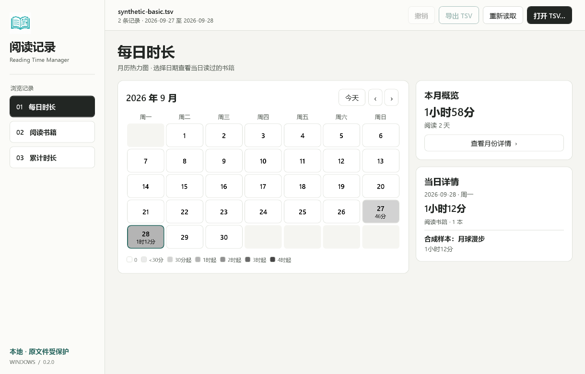
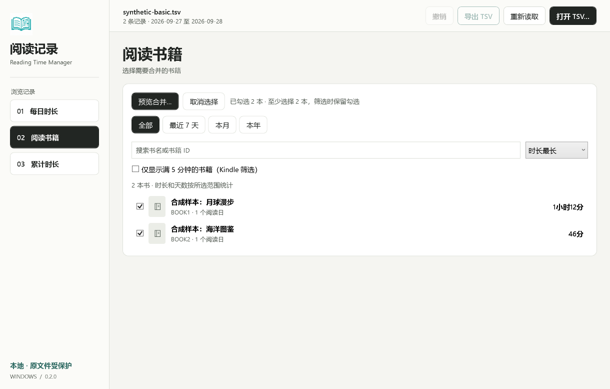
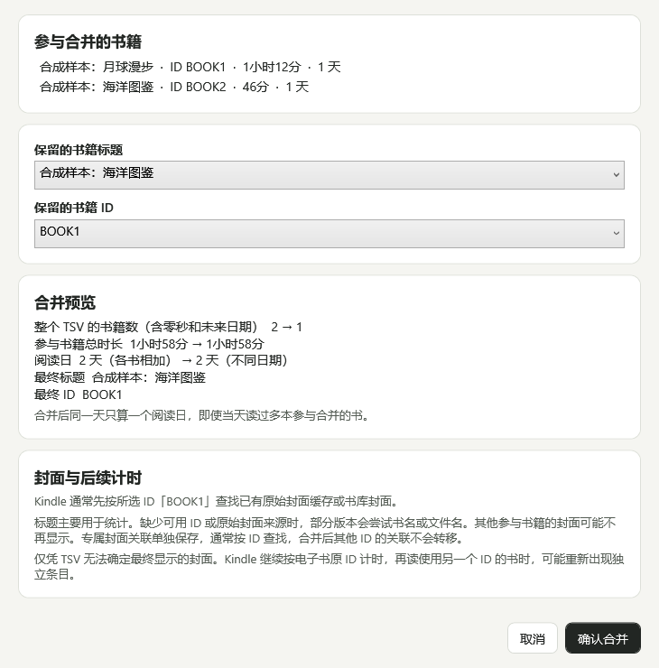

# Reading Time Manager 0.2.0

Reading Time Manager 是一个 Windows 桌面工具，用来打开 Kindle 阅读统计插件生成的 `reading-time.tsv`，查看每日、书籍和累计统计，合并书籍记录并另存完整 TSV。导入的文件始终受保护。

[下载 v0.2.0 · Windows x64](https://github.com/L-1116/reading-time-manager/releases/tag/v0.2.0) · [Kindle 阅读时长统计插件](https://github.com/L-1116/kindle-reading-records-enhanced)

## 使用

解压 Windows x64 ZIP，双击顶层的 `ReadingTimeManager.exe`。`app/` 内是程序依赖，不需要打开；请将它和 EXE 一起移动。无需安装 .NET 或 Python。升级时解压到新目录，不要覆盖旧版的平铺目录。

从应用的「打开 TSV…」选取 Kindle 的 `reading-time/reading-time.tsv`，或把单个 `.tsv` 拖到窗口。应用会尝试恢复上次成功打开的路径，也可以用「重新读取」刷新数据。只用只读权限打开记录；记忆路径保存在 Windows 当前用户注册表 `HKCU\Software\ReadingTimeManager`，不在 Kindle 数据目录。

- **每日时长**：灰度月历、按日分书明细，以及月份概览、排名和趋势。
- **阅读书籍**：书名或 ID 搜索、范围和排序、单书指标及月历。默认显示有正时长的全部书籍；可启用 Kindle 的满 5 分钟筛选。
- **累计时长**：按周、年、全部历史查看时长、阅读日、书数和趋势，支持最近 8 周详情。

导入使用当前 Kindle Standard 源码与历史版本的 `date / book_id / seconds / title` 表头，秒数按日和书聚合。同名不同 ID 不在书架或单书统计中合并；月份排名采用 Kindle 的按显示书名汇总口径。未来日期保留在日历及相关详情，但不计入截至今天的累计统计和书籍列表。封面、阅读进度和小时明细并不在这个 TSV 中，客户端不会猜测。损坏文件会报告原因，且不会导入部分数据。

## 合并与导出

1. 在「阅读书籍」点击「合并书籍」，勾选至少两本书，再点「预览合并」。搜索或切换筛选时会保留已勾选项。
2. 分别选择要保留的原标题和书籍 ID。预览按完整历史统计，包含未来日期。同一天读过多本参与书籍时，合并后按同一阅读日计算。空 ID 和 `unknown` 的记录按原标题识别，有可用标题时可并入一个有效 ID。一个 ID 对应多个可用原标题时，软件会阻止涉及该 ID 的合并。
3. 确认后，三个统计视图会使用合并后的数据。「撤销」可逐步恢复此前的状态。重新导入或退出应用会清空撤销历史；已经导出的文件照常保留。
4. 点「导出 TSV」，选一个空闲路径。推荐文件名为 `reading-time.tsv`。导出保留原始记录顺序、日期和秒数，包括重复行和零秒记录。应用会校验记录数、每日和累计秒数，重新读取临时 TSV 后才将其保存为目标文件。目标位置须无同名文件。

### Kindle 上的封面和后续阅读

原始封面优先查找保留 ID 对应的缓存、书库目录和缩略图。缺少 ID 时部分版本会按书名匹配目录，某些原始封面来源不可用时还会尝试 `documents` 中的标题对应文件。支持自定义封面的版本会另查专属关联（通常以 ID 为键），再尝试通用替代封面。其他参与书籍的封面可能不再出现，实际结果取决于设备现有目录、文件、缓存和设置。

Kindle 计时服务继续使用原电子书的 `cdeKey`。日后阅读另一个 ID 对应的电子书时，可能再次出现独立书籍条目。合并所选标题可能影响按标题汇总的书籍排名，各日期和时间范围的时长维持原值。

### 手动放回 Kindle

以下流程适用于原插件仅以 `reading-time.tsv` 保存计时数据、且使用 `native-reading-time` Upstart 作业的设备。设备端停启作业请由熟悉该机 Kindle 维护方式的人员完成。

1. 先退出电子书回到书库，保持设备唤醒，留出两个正常的 5 秒采样周期，让 daemon 在看到退出阅读时写出缓冲。关闭统计界面，在 Kindle 上正常停止 `native-reading-time` 作业，确认状态为 `stop/waiting`，且没有其他计时进程。维护端对应的 Upstart 操作为 `/sbin/initctl stop native-reading-time` 和 `/sbin/initctl status native-reading-time`。daemon 正常收到 TERM 时也会尝试写出缓冲。停止失败或无法确认时请保留设备原文件。
2. 服务停止后，先把 `/mnt/us/reading-time/reading-time.tsv` 备份到电脑。以这份最新副本重新合并，避免覆盖整理期间 Kindle 新增的记录。将导出文件传到同一个 Kindle 数据目录中的临时名字，确认复制完整后再将它替换为 `reading-time.tsv`。保留原始备份，等替换完成后再打开统计界面，因为部分版本会在打开时恢复计时服务。
3. 恢复原有 Upstart 作业（维护端为 `/sbin/initctl start native-reading-time`），确认状态为 `start/running`，然后重开「阅读记录」。统计缓存随新会话从 TSV 重建。封面缓存和自定义封面关联留在设备原位置。

以上停止、写出缓冲和重启机制来自已检查的 [Kindle daemon 与 Upstart 配置](https://github.com/L-1116/kindle-reading-records-enhanced/tree/04a3e9e9b4536d6f9d8d77bf4efbc3be67b335e2/native-reading-time-package)。0.2.0 已做离线 AWK 和 daemon 追加测试。设备上的 Upstart 停启、复制或弹出期间的服务行为，以及实际封面显示仍需 Kindle 真机验证。遇到不同作业、仅有 USB 访问或无法确认服务状态时，请先保留导出文件和设备原件。

如果设备有 `reading-intervals.tsv` 或未完成的计时事务，请保留导出文件供电脑使用，暂停手动替换。9.8.3 测试分支的 `reading-data.sh` 和 `reading-hours.lua` 分别处理日汇总和按书计时区段。单换日汇总后，旧 ID 的小时明细仍在原处，目标书的小时分布可能只显示部分记录。未完成事务还可能依赖原文件的字节偏移。

## 界面演示

截图使用合成阅读记录。

| 每日统计 | 勾选书籍 | 合并预览 |
| --- | --- | --- |
| [](docs/images/daily.png) | [](docs/images/merge-selection.png) | [](docs/images/merge-confirm.png) |

## 开发

`Core/` 保存 TSV 读取、编辑与统计，`App/` 是 WPF UI，`Tests/` 使用合成记录。开发需要 .NET 10 SDK。`App/Assets` 已包含从插件 Standard `launcher-icon.png` 裁切缩放的图标，正常构建无需 Python。重建图标时使用 Python + Pillow，并运行 `python convert_icon.py <原版 launcher-icon.png 路径>`。

```powershell
dotnet run --project Tests -c Release
$out = 'dist/Reading-Time-Manager-0.2.0-win-x64'
dotnet publish App -c Release -r win-x64 --self-contained true -p:DebugType=None -o $out
if ($LASTEXITCODE) { throw 'Publish failed' }
& ./Tests/Test-PublishedManifest.ps1 -ExePath "$out/ReadingTimeManager.exe"
Compress-Archive -Path $out -DestinationPath "$out.zip" -Force
```

测试使用离屏布局。可用 `-- <输出目录>` 生成 PNG，也可用 `-- <输出目录> <awk.exe 路径> <原版 reading-insights-cache.awk 路径>` 对照 Kindle 原版聚合。继续加上 `<Git Bash 路径> <一个或多个原版 daemon 脚本路径>` 可检查原版追加以及 TERM 写出缓冲的行为，使用固定的书籍元数据和计时桶。带写入日志的版本需要在 daemon 脚本旁放置其同版本的 `reading-data.sh`。
